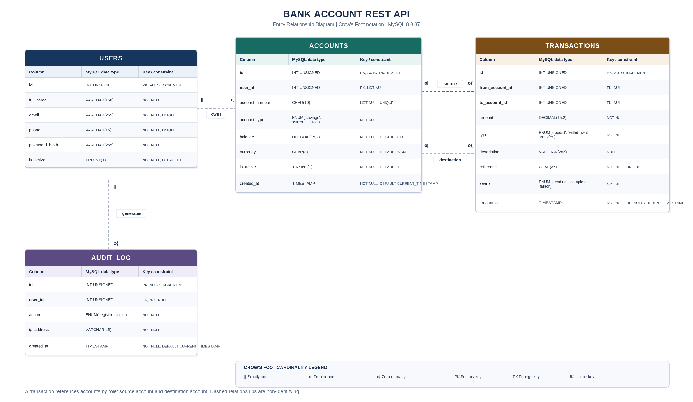

# Bank Account REST API

A REST API for customer registration, authentication, bank account management, and financial transactions. The application uses Node.js, Express, and MySQL.

## Features

- Customer registration with full-name, email, phone-number, and password validation.
- Password hashing with bcrypt.
- JWT-based authentication for protected routes.
- Login and registration audit logging.
- Creation and listing of customer accounts.
- Account details and account ownership checks.
- Deposit, withdrawal, and account-to-account transfer operations.
- Transaction history with pagination.
- Customer account summaries using SQL aggregate functions and correlated subqueries.
- Database constraints, foreign keys, and indexes to protect data integrity.
- Database transactions and row locking for financial operations.

## Technology stack

- Node.js, ES modules
- Express 5
- MySQL 8.0.16 or later
- mysql2/promise
- JSON Web Token (jsonwebtoken)
- bcrypt
- Joi
- dotenv

The project was developed and tested with Node.js 24.14.1 and MySQL 8.0.37.

## Database design

The database contains four main tables:

| Table | Purpose |
|---|---|
| `users` | Stores customer identity, contact details, password hashes, and account status. |
| `accounts` | Stores customer bank accounts, account numbers, account types, balances, currencies, and status. |
| `transactions` | Stores deposits, withdrawals, and transfers in a shared transaction ledger. |
| `audit_log` | Records customer registration and successful login events. |

The schema uses InnoDB, `utf8mb4`, foreign keys, unique constraints, check constraints, and indexes. Monetary values use `DECIMAL(15,2)`. Account numbers and phone numbers use character columns so leading zeroes remain intact.

The account types are `savings`, `current`, and `fixed`. Each customer is limited to three active accounts. Account numbers contain exactly 10 digits. New accounts use `NGN` as the default currency.

### Entity relationship diagram



The database design rationale, relationship mapping, normalisation review, ERD source, and index plan are documented in [design.md](design.md). The executable database definition is in [schema.sql](schema.sql).

## Requirements

- Node.js and npm
- MySQL 8.0.16 or later
- A MySQL user with permission to create a database and tables

## Installation and setup

### 1. Clone the repository

```bash
git clone <repository-url>
cd Bank_api
```

Replace `<repository-url>` with the Git repository URL supplied for this assignment.

### 2. Install dependencies

```bash
npm install
```

### 3. Create your environment file

On Windows PowerShell:

```powershell
Copy-Item .env.example .env
```

On macOS or Linux:

```bash
cp .env.example .env
```

Open `.env` and replace the example values with your local MySQL credentials. Set a private JWT secret. Do not commit `.env` or share its values.

You can generate a random JWT secret with Node.js:

```bash
node --input-type=module -e "import { randomBytes } from 'node:crypto'; console.log(randomBytes(64).toString('hex'))"
```

### 4. Configure the environment variables

The application reads the following variables:

| Variable | Description | Example |
|---|---|---|
| `PORT` | HTTP server port | `3000` |
| `DB_HOST` | MySQL host | `localhost` |
| `DB_PORT` | MySQL port | `3306` |
| `DB_USER` | MySQL username | `root` |
| `DB_PASSWORD` | MySQL password | Set your local value |
| `DB_NAME` | Database name | `bank_api` |
| `JWT_SECRET` | Secret used to sign and verify JWTs | Set a long random value |
| `JWT_EXPIRES_IN` | JWT lifetime | `1h` |
| `BCRYPT_SALT_ROUNDS` | bcrypt work factor | `10` |

The `.env.example` file contains placeholders. Use your own values in `.env`.

### 5. Create the database schema

The supplied `schema.sql` creates the `bank_api` database when it does not exist, selects it, and creates the four tables.

From a terminal where the MySQL client is available, run:

```bash
mysql -u root -p < schema.sql
```

Alternatively, open the MySQL client:

```bash
mysql -u root -p
```

Then run the schema file with the MySQL `SOURCE` command. Replace the path with the full path to your local project file:

```sql
SOURCE C:/path/to/Bank_api/schema.sql;
```

Important: `schema.sql` drops and recreates the four application tables before creating them. Running it against a database with existing application records deletes those records. Use a disposable development database or back up your data before running the script.

### 6. Start the application

Development mode, using Node's watch mode:

```bash
npm run dev
```

Standard start:

```bash
npm start
```

The server checks its MySQL connection before listening on the configured port. The default local API base URL is:

```text
http://localhost:3000
```

### 7. Check the server and database connection

Send a GET request to:

```http
GET http://localhost:3000/health
```

Expected response when the server and database are available:

```json
{
  "status": "ok",
  "database": "connected"
}
```

## API reference

Base URL:

```text
http://localhost:3000
```

Protected endpoints require this HTTP header:

```http
Authorization: Bearer <JWT>
```

### Authentication

#### Register a customer

```http
POST /api/auth/register
Content-Type: application/json
```

Request body:

```json
{
  "full_name": "Asabe Nasir",
  "email": "asabe@example.com",
  "phone": "08012345678",
  "password": "SecurePass@123",
  "confirm_password": "SecurePass@123"
}
```

Validation rules:

- `full_name` must contain 2 to 150 characters.
- `email` must be valid. The application trims and converts it to lowercase.
- `phone` must contain 10 to 15 digits.
- `password` must contain at least 8 characters, one uppercase letter, one digit, and one special character.
- `confirm_password` must match `password`.

Successful response: HTTP 201.

```json
{
  "id": 1,
  "full_name": "Asabe Nasir",
  "email": "asabe@example.com"
}
```

The application hashes the password before storing it. Registration and its audit event are committed in one database transaction. A duplicate email address or phone number returns HTTP 409.

#### Log in

```http
POST /api/auth/login
Content-Type: application/json
```

Request body:

```json
{
  "email": "asabe@example.com",
  "password": "SecurePass@123"
}
```

Successful response: HTTP 200. The response contains a JWT, its token type and expiry, and public customer details.

```json
{
  "message": "Login successful",
  "token": "<JWT>",
  "token_type": "Bearer",
  "expires_in": "1h",
  "user": {
    "id": 1,
    "full_name": "Asabe Nasir",
    "email": "ada@example.com"
  }
}
```

Invalid credentials return HTTP 401. A successful login creates an audit event.

#### Get the authenticated customer

```http
GET /api/auth/me
Authorization: Bearer <JWT>
```

Returns the authenticated customer's public information.

### Account management

All account management endpoints below require a valid JWT.

#### Create an account

```http
POST /api/accounts
Authorization: Bearer <JWT>
Content-Type: application/json
```

Request body:

```json
{
  "account_type": "savings",
  "currency": "NGN"
}
```

Allowed account types: `savings`, `current`, and `fixed`. The `currency` field is optional and defaults to `NGN`. When supplied, it must contain exactly three uppercase letters. A customer cannot have more than three active accounts. An invalid account type or an account-limit violation returns HTTP 400.

#### List customer accounts

```http
GET /api/accounts
Authorization: Bearer <JWT>
```

Returns the authenticated customer's active accounts. The API applies customer ownership using the identity in the verified JWT, not a customer ID supplied by the caller.

#### Get account details

```http
GET /api/accounts/:account_number
Authorization: Bearer <JWT>
```

Replace `:account_number` with the account's 10-digit number.

The response includes account details, owner name and email, and the total number of transactions involving the account. The API returns HTTP 403 when the account belongs to another customer and HTTP 404 when the account does not exist.

#### Get the customer account summary

```http
GET /api/accounts/summary
Authorization: Bearer <JWT>
```

Returns a summary for the authenticated customer. The summary contains:

- Customer name and email.
- Number of active accounts.
- Combined account balance.
- Highest and lowest active-account balances.
- Total debit and credit transaction counts.

A customer without active accounts receives HTTP 404.

### Financial transactions

All financial transaction endpoints require a valid JWT. Amounts must be greater than zero and contain no more than two decimal places. Descriptions are optional and limited to 255 characters.

#### Deposit

```http
POST /api/accounts/deposit
Authorization: Bearer <JWT>
Content-Type: application/json
```

Request body:

```json
{
  "account_number": "0123456789",
  "amount": 5000.00,
  "description": "Cash deposit"
}
```

A successful deposit updates the account balance and inserts a completed transaction record within one database transaction. The response includes the transaction reference and updated account balance.

#### Withdraw

```http
POST /api/accounts/withdraw
Authorization: Bearer <JWT>
Content-Type: application/json
```

Request body:

```json
{
  "account_number": "0123456789",
  "amount": 1000.00,
  "description": "Cash withdrawal"
}
```

The API checks ownership, account status, and available funds before deducting money. An insufficient balance returns HTTP 422. A successful withdrawal updates the balance and records the completed transaction in one database transaction.

#### Transfer

```http
POST /api/accounts/transfer
Authorization: Bearer <JWT>
Content-Type: application/json
```

Request body:

```json
{
  "from_account_number": "0123456789",
  "to_account_number": "9876543210",
  "amount": 1500.00,
  "description": "Account transfer"
}
```

The source and destination account numbers must differ. The authenticated customer must own the source account. Both accounts must be active and use the same currency. The API does not perform currency conversion.

The transfer locks both accounts in a consistent order, checks available funds, updates the debit and credit balances, and records one completed transfer transaction. It commits these operations together. A failed operation rolls back the database transaction. Insufficient funds return HTTP 422.

### Transaction history

```http
GET /api/accounts/:account_number/history?page=1&limit=10
Authorization: Bearer <JWT>
```

The endpoint returns transactions where the requested account is either the source or destination account. It includes source and destination account numbers and owner names where applicable.

Pagination parameters:

| Parameter | Default | Rule |
|---|---:|---|
| `page` | `1` | Positive integer |
| `limit` | `10` | Integer from 1 to 100 |

The response contains the account number, pagination metadata, and the transaction records. Transactions are ordered by creation time, newest first, with transaction ID as a tie-breaker.

## Authentication and access control

- Registration and login are public routes.
- All account and transaction routes require a Bearer JWT.
- The authentication middleware verifies JWT signatures using HS256.
- The middleware checks the JWT subject and retrieves the current customer record from MySQL.
- Inactive customers are blocked from protected routes.
- Account operations verify ownership before accessing or changing account data.
- Passwords are stored as bcrypt hashes, not plaintext values.
- Registration and successful login events are written to `audit_log`.

## Validation and common errors

The API uses Joi schemas and a validation middleware. Validation failures return HTTP 400 with an error message and a `details` array.

Common response codes:

| Status | Meaning | Example |
|---:|---|---|
| 400 | Invalid request or business-rule violation | Invalid account type, invalid amount, invalid pagination, inactive account |
| 401 | Authentication required or invalid | Missing, expired, or invalid JWT; invalid login credentials |
| 403 | Authenticated customer lacks access | Account belongs to another customer |
| 404 | Requested resource not found | Account not found or no active accounts found |
| 409 | Duplicate registration details | Email or phone number already registered |
| 422 | Financial operation rejected | Insufficient funds |
| 500 | Unexpected application or database error | Failed database operation |

Unknown routes return HTTP 404 with `{"error":"Route not found"}`.

## Project structure

```text
Bank_api/
├── assets/
│   ├── bank-api-erd.png
│   └── bank-api-erd.svg
├── controllers/
│   ├── accountController.js
│   └── authController.js
├── middleware/
│   ├── authenticate.js
│   └── validate.js
├── validators/
│   ├── accountValidators.js
│   └── authValidators.js
├── .env.example
├── .gitignore
├── db.js
├── design.md
├── index.js
├── package-lock.json
├── package.json
├── router.js
├── schema.sql
└── test-db.js
```

## Testing

API acceptance tests were executed using Postman during development. Testing covered all ten acceptance criteria: user registration, user login, account creation, account listing, account details, deposits, withdrawals, transfers, transaction history, and account summaries.

Negative test cases covered invalid request data, missing or invalid authentication, duplicate registration details, account creation limits, insufficient funds, same-account transfers, and unauthorised access to another customer's account.

API responses and corresponding database records were verified where applicable.


## Database integrity and financial consistency

- Foreign keys preserve relationships between customers, accounts, transactions, and audit events.
- Unique constraints protect customer email addresses, phone numbers, account numbers, and transaction references.
- Check constraints enforce valid phone and account-number formats, positive transaction amounts, non-negative balances, and valid transaction account roles.
- Financial amounts use `DECIMAL(15,2)`.
- Deposit, withdrawal, and transfer operations use explicit MySQL transactions.
- Account rows are locked during financial updates to protect balance changes from conflicting concurrent operations.
- Failed financial operations roll back their database changes.

## Project documentation

- [Database design and normalisation](design.md)
- [Executable MySQL schema](schema.sql)
- [Entity relationship diagram](assets/bank-api-erd.png)

## Author

Asabe Nasir
