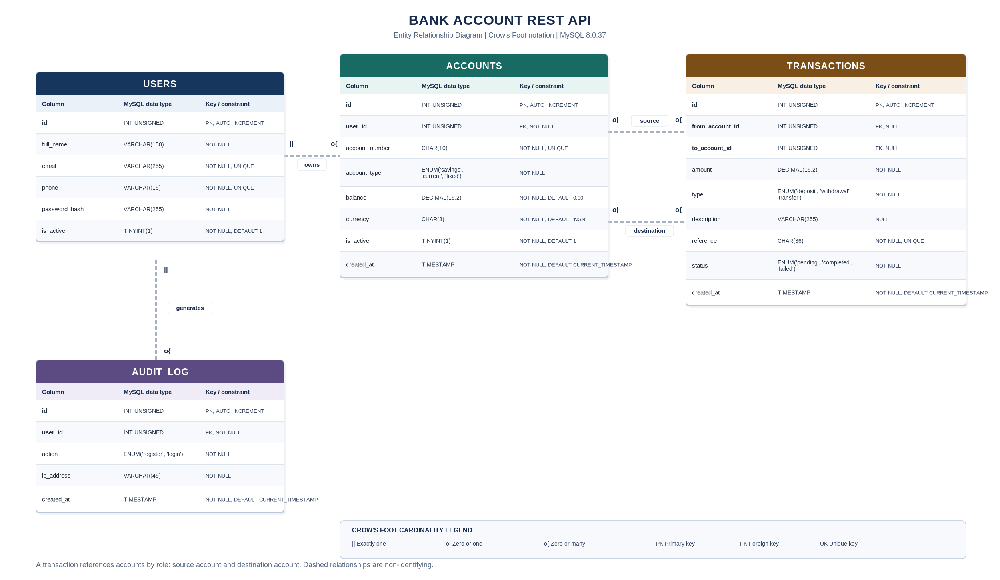
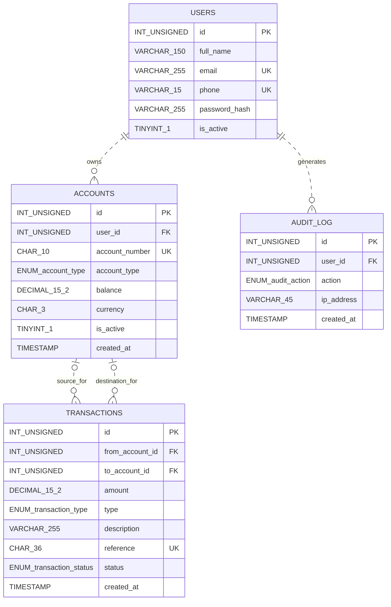

# Bank Account REST API
## Phase 1: Database Design

**Project:** Bank Account REST API: Design, Normalise, and Build  
**Language:** JavaScript (Node.js and Express)  
**Database:** MySQL  
**Design target:** Third Normal Form (3NF)  
**ERD notation:** Crow's Foot  

---

## 1. Entity Identification

The business rules require the application to store information about customers, bank accounts, financial transactions, and authentication events. The initial design contains four entities.

### 1.1 `users`

**Description:** Represents people who register with and use the banking application.

**Real-world concept:** A bank customer or account holder.

**Reason for a separate table:** The application must maintain each customer's identity and login credentials independently of the customer's accounts and financial activity. A user may own multiple accounts. The user record also provides the identity used for authentication and account-ownership checks.

**Supporting business rules:**
- A person registers with a full name, unique email address, unique phone number, and password.
- A user can be active or inactive.
- An inactive user cannot log in.

### 1.2 `accounts`

**Description:** Represents bank accounts opened by registered users.

**Real-world concept:** A customer's bank account.

**Reason for a separate table:** Each account has its own account number, type, currency, balance, and status. A user can own more than one account, so account records must be stored separately and linked to their owner.

**Supporting business rules:**
- A registered user can open one or more accounts.
- A user cannot hold more than three active accounts at the same time.
- Each account belongs to exactly one user.
- Each account has a unique 10-digit account number, an account type, a balance, and a currency.
- Financial operations cannot be performed on an inactive account.

### 1.3 `transactions`

**Description:** Represents deposits, withdrawals, and transfers performed on bank accounts.

**Real-world concept:** A financial transaction or movement of funds.

**Reason for a separate table:** The application must retain an independently identifiable record of each financial operation. Each transaction has its own amount, type, reference, status, timestamp, and account relationship. Keeping transactions separate from account balances allows the application to retrieve an account's transaction history.

**Supporting business rules:**
- Money can enter an account through a deposit.
- Money can leave an account through a withdrawal.
- Money can move between two accounts through a transfer.
- Every transaction records an amount, type, optional description, unique reference, creation time, and status.
- A deposit has a destination account and no source account.
- A withdrawal has a source account and no destination account.
- A transfer has both a source account and a destination account.
- The system must be able to reconstruct an account's transaction history.

**Design decision:** Deposits, withdrawals, and transfers are transaction types, not three separate entities. They share the same core attributes and are stored in one `transactions` table. The `type` column identifies the operation, while nullable source and destination foreign keys represent the different account roles.

### 1.4 `audit_log`

**Description:** Represents user registration and login events.

**Real-world concept:** An authentication audit event.

**Reason for a separate table:** A user can log in many times. Every registration or login event must be recorded with its own action, IP address, and timestamp. A separate table preserves multiple events without overwriting information in the user record.

**Supporting business rule:** Every time a user registers or logs in, the application records the user, action, request IP address, and event time.

### 1.5 Concepts kept as attributes rather than separate entities

| Concept | Design decision | Reason |
|---|---|---|
| Deposit | `transactions.type` value | A deposit shares the transaction attributes and structure. |
| Withdrawal | `transactions.type` value | A withdrawal shares the transaction attributes and structure. |
| Transfer | `transactions.type` value | A transfer shares the transaction attributes and structure. |
| Account type | `accounts.account_type` | The assignment defines three allowed values: savings, current, and fixed. |
| Account status | `accounts.is_active` | Active/inactive describes the state of an account. |
| User status | `users.is_active` | Active/inactive describes the state of a user. |
| Transaction status | `transactions.status` | Pending/completed/failed describes the state of a transaction. |
| Currency | `accounts.currency` | The assignment requires a three-character currency code for each account. It does not require a currency reference table. |

---

## 2. Attribute Mapping

This section lists the proposed columns, MySQL data types, nullability, constraints, and reasons for the main type choices.

### 2.1 `users`

| Attribute | MySQL data type | Required? | Constraints | Reason |
|---|---|---|---|---|
| `id` | `INT UNSIGNED` | Yes | Primary key, `AUTO_INCREMENT` | Surrogate identifier generated by the database. `UNSIGNED` disallows negative IDs. |
| `full_name` | `VARCHAR(150)` | Yes | `NOT NULL` | Stores a name with variable length, up to the assignment's 150-character limit. |
| `email` | `VARCHAR(255)` | Yes | `NOT NULL`, `UNIQUE` | Stores an email address. A unique constraint prevents duplicate email addresses. |
| `phone` | `VARCHAR(15)` | Yes | `NOT NULL`, `UNIQUE`, `CHECK` for 10–15 digits | A phone number is an identifier, not a quantity. A character type preserves leading zeroes. Joi validation and a database check enforce 10–15 numeric characters. |
| `password_hash` | `VARCHAR(255)` | Yes | `NOT NULL` | Stores a bcrypt hash, never the submitted plaintext password. The length leaves room for supported hash formats. |
| `is_active` | `TINYINT(1)` | Yes | `NOT NULL`, `DEFAULT 1`, `CHECK (is_active IN (0, 1))` | MySQL represents `BOOLEAN` as a numeric type. The check restricts the stored value to 0 or 1. |

**Notes:**
- The database column is named `password_hash` to make clear that it stores a hash rather than a plaintext password.
- The registration validator lowercases email addresses before insertion, supporting consistent duplicate checks.


### 2.2 `accounts`

| Attribute | MySQL data type | Required? | Constraints | Reason |
|---|---|---|---|---|
| `id` | `INT UNSIGNED` | Yes | Primary key, `AUTO_INCREMENT` | Surrogate identifier generated by the database. |
| `user_id` | `INT UNSIGNED` | Yes | `NOT NULL`, foreign key to `users.id` | Identifies the owner. Its type must match the referenced primary key. |
| `account_number` | `CHAR(10)` | Yes | `NOT NULL`, `UNIQUE`, `CHECK` for exactly 10 digits | An account number is a fixed-length identifier, not a number for arithmetic. A character type preserves leading zeroes. The application generates ten digits, and a database check rejects non-digit or incorrectly sized values. |
| `account_type` | `ENUM('savings', 'current', 'fixed')` | Yes | `NOT NULL` | Restricts the account type to the three values allowed by the assignment. |
| `balance` | `DECIMAL(15,2)` | Yes | `NOT NULL`, `DEFAULT 0.00`, `CHECK (balance >= 0)` | Fixed-point decimal storage is appropriate for money. It avoids the approximate representation associated with `FLOAT`. |
| `currency` | `CHAR(3)` | Yes | `NOT NULL`, `DEFAULT 'NGN'`, `CHECK` for three uppercase letters | Stores a three-character currency code. Joi validation and a database check enforce three uppercase letters. |
| `is_active` | `TINYINT(1)` | Yes | `NOT NULL`, `DEFAULT 1`, `CHECK (is_active IN (0, 1))` | Stores whether financial operations are permitted on the account. |
| `created_at` | `TIMESTAMP` | Yes | `NOT NULL`, `DEFAULT CURRENT_TIMESTAMP` | Records account creation time and supports ordering in the account-list query. |

**Notes:**
- `CHAR(10)` is used rather than an integer because account numbers can begin with zero and are not used for arithmetic.
- `DECIMAL(15,2)` allows 13 digits before the decimal point and two digits after it.
- The non-negative balance check protects the database from negative stored balances. Application logic and transaction locking are also required to protect concurrent financial operations.
- The account limit of three active accounts per user is a cross-row rule. A normal `CHECK` constraint cannot safely enforce a count across multiple rows. The application must enforce it inside a transaction while locking the user's row.

### 2.3 `transactions`

| Attribute | MySQL data type | Required? | Constraints | Reason |
|---|---|---|---|---|
| `id` | `INT UNSIGNED` | Yes | Primary key, `AUTO_INCREMENT` | Surrogate identifier for each transaction. |
| `from_account_id` | `INT UNSIGNED` | No | Nullable foreign key to `accounts.id` | Deposits have no source account, so this column must allow `NULL`. Withdrawals and transfers require a source. |
| `to_account_id` | `INT UNSIGNED` | No | Nullable foreign key to `accounts.id` | Withdrawals have no destination account, so this column must allow `NULL`. Deposits and transfers require a destination. |
| `amount` | `DECIMAL(15,2)` | Yes | `NOT NULL`, `CHECK (amount > 0)` | Stores an exact monetary amount and prevents zero or negative transaction amounts. |
| `type` | `ENUM('deposit', 'withdrawal', 'transfer')` | Yes | `NOT NULL` | Restricts the transaction type to the three operations in the assignment. |
| `description` | `VARCHAR(255)` | No | `NULL` allowed | Stores an optional transaction description. |
| `reference` | `CHAR(36)` | Yes | `NOT NULL`, `UNIQUE` | Stores a unique transaction reference. A standard UUID has 36 characters including hyphens. |
| `status` | `ENUM('pending', 'completed', 'failed')` | Yes | `NOT NULL` | Restricts the transaction status to the values in the assignment. The application must set the status explicitly for each transaction. |
| `created_at` | `TIMESTAMP` | Yes | `NOT NULL`, `DEFAULT CURRENT_TIMESTAMP` | Records when the transaction was created and supports history ordering. |

**Transaction relationship constraints:**
- A deposit must have `from_account_id IS NULL` and `to_account_id IS NOT NULL`.
- A withdrawal must have `from_account_id IS NOT NULL` and `to_account_id IS NULL`.
- A transfer must have both foreign keys populated.
- A transfer must not use the same account as both source and destination.
- `amount` must be greater than zero.

These rules should be enforced with database `CHECK` constraints and validated in application logic. MySQL must be version 8.0.16 or later for enforced `CHECK` constraints.

### 2.4 `audit_log`

| Attribute | MySQL data type | Required? | Constraints | Reason |
|---|---|---|---|---|
| `id` | `INT UNSIGNED` | Yes | Primary key, `AUTO_INCREMENT` | Surrogate identifier for each audit event. |
| `user_id` | `INT UNSIGNED` | Yes | `NOT NULL`, foreign key to `users.id` | Identifies the user associated with the event. |
| `action` | `ENUM('register', 'login')` | Yes | `NOT NULL` | Restricts the action to the two authentication events specified by the assignment. |
| `ip_address` | `VARCHAR(45)` | Yes | `NOT NULL` | Holds the longest textual IPv6 address representation and also accommodates IPv4. |
| `created_at` | `TIMESTAMP` | Yes | `NOT NULL`, `DEFAULT CURRENT_TIMESTAMP` | Records when the authentication event occurred. |

### 2.5 Important type choices

**`DECIMAL` rather than `FLOAT`:** Financial values require exact decimal storage. `FLOAT` uses approximate binary floating-point representation and is unsuitable for storing account balances.

**Character types for phone and account numbers:** These values identify people or accounts. They are not used in arithmetic. Character types preserve leading zeroes.

**`TINYINT(1)` for boolean-like flags:** MySQL's `BOOLEAN` is an alias for `TINYINT(1)`. The display width does not itself restrict values to 0 and 1, so the design adds a `CHECK` constraint.

**`TIMESTAMP` for event times:** The columns default to the database's current timestamp. The application and database session should use a consistent timezone, preferably UTC, so stored and returned event times are interpreted consistently.

---

## 3. Relationship Mapping

The design uses four one-to-many relationships. The foreign key is placed on the child table, where each child record stores the identifier of its parent.

| Relationship | Cardinality | Foreign key location | `ON DELETE` | Justification |
|---|---|---|---|---|
| Users → Accounts | One-to-Many (1:N) | `accounts.user_id` | `RESTRICT` | Each account belongs to exactly one user. A user can own zero or more account records over time. Preventing deletion protects account ownership and financial history. |
| Users → Audit Log | One-to-Many (1:N) | `audit_log.user_id` | `RESTRICT` | Each audit event belongs to one user, and a user can generate many events. Preventing deletion preserves authentication history. |
| Accounts → Transactions (source role) | One-to-Many (1:N) | `transactions.from_account_id` | `RESTRICT` | A transaction has zero or one source account. An account can be the source of many transactions. Restricting deletion preserves the source account reference. |
| Accounts → Transactions (destination role) | One-to-Many (1:N) | `transactions.to_account_id` | `RESTRICT` | A transaction has zero or one destination account. An account can receive many transactions. Restricting deletion preserves the destination account reference. |

### 3.1 Relationship explanations

**Users and Accounts:** One user may own multiple accounts, while each account must belong to exactly one user. A newly registered user may have no account yet, so the user-to-account participation is zero or many over the user's lifecycle. The `accounts.user_id` foreign key is `NOT NULL` because an account cannot exist without an owner.

**Users and Audit Log:** One user may generate many registration or login events. Each audit event belongs to exactly one user. The foreign key is `audit_log.user_id`.

**Accounts and Transactions:** Accounts participate in transactions in two separate roles: source and destination. Both foreign keys reference `accounts.id`. A deposit has no source, a withdrawal has no destination, and a transfer has both. The two foreign keys are nullable because their nullability depends on transaction type.

### 3.2 Referential actions

- `RESTRICT` prevents deletion of a parent record while child records reference it. This is appropriate for users, accounts, financial transactions, and audit records because deletion must not erase or disconnect financial history.
- `CASCADE` automatically deletes dependent child rows. It is not selected because cascading deletion could destroy audit or financial records.
- `SET NULL` removes the child-to-parent association by setting the foreign key to `NULL`. It is not selected because the source and destination account references are needed to reconstruct financial history. The nullable transaction foreign keys represent transaction types, not permission to erase an existing relationship.

The application should deactivate users and accounts instead of physically deleting records that participate in financial history.

### 3.3 Many-to-many consideration

Accounts can send money to and receive money from many other accounts over time. This creates a many-to-many interaction between accounts. The `transactions` table represents each individual interaction as an associative entity and stores its amount, type, reference, status, and timestamp. A separate account-to-account junction table is not required for this design.

---

## 4. Entity Relationship Diagram

**Notation:** Crow's Foot.  
**Relationship line:** Dashed lines indicate non-identifying relationships because each child table has its own independent primary key.  

### 4.1 Rendered ERD (PNG)

The following diagram shows all four entities, their attributes and MySQL data types, primary and foreign keys, and relationship cardinalities. The PNG is stored at `assets/bank-api-erd.png` relative to this document.



The editable Mermaid source is retained below. The Mermaid data type legend maps its readable labels to the exact MySQL data types.

### 4.2 Mermaid ERD source



### 4.3 Mermaid data type legend

| Mermaid label | Actual MySQL data type |
|---|---|
| `INT_UNSIGNED` | `INT UNSIGNED` |
| `VARCHAR_150` | `VARCHAR(150)` |
| `VARCHAR_255` | `VARCHAR(255)` |
| `VARCHAR_15` | `VARCHAR(15)` |
| `VARCHAR_45` | `VARCHAR(45)` |
| `TINYINT_1` | `TINYINT(1)` |
| `CHAR_10` | `CHAR(10)` |
| `CHAR_36` | `CHAR(36)` |
| `CHAR_3` | `CHAR(3)` |
| `DECIMAL_15_2` | `DECIMAL(15,2)` |
| `ENUM_account_type` | `ENUM('savings', 'current', 'fixed')` |
| `ENUM_transaction_type` | `ENUM('deposit', 'withdrawal', 'transfer')` |
| `ENUM_transaction_status` | `ENUM('pending', 'completed', 'failed')` |
| `ENUM_audit_action` | `ENUM('register', 'login')` |
| `TIMESTAMP` | `TIMESTAMP` |

### 4.4 Cardinality interpretation

- `USERS ||..o{ ACCOUNTS`: Each account belongs to exactly one user. A user can own zero or many accounts over time.
- `USERS ||..o{ AUDIT_LOG`: Each audit event belongs to exactly one user. A user can generate zero or many audit events.
- `ACCOUNTS o|..o{ TRANSACTIONS` for `source_for`: Each transaction has zero or one source account. An account can be the source of zero or many transactions.
- `ACCOUNTS o|..o{ TRANSACTIONS` for `destination_for`: Each transaction has zero or one destination account. An account can be the destination of zero or many transactions.

The nullable source and destination foreign keys are constrained by the transaction type in the database schema and application logic.

**Submission image:** The rendered PNG is included at `assets/bank-api-erd.png`. Keep the Mermaid source above in `design.md` so the diagram remains editable.

---

## 5. Normalisation

The proposed schema is reviewed against First Normal Form (1NF), Second Normal Form (2NF), and Third Normal Form (3NF).

### 5.1 First Normal Form (1NF)

A table satisfies 1NF when:
- Each row represents one record of the entity.
- Each column contains one atomic value for the purpose of the application.
- There are no repeating groups of columns.
- Each row can be uniquely identified by a key.

**Example of a 1NF violation:** Storing multiple phone numbers in one `phone_numbers` column would put multiple values in a single field.

| id | full_name | phone_numbers |
|---|---|---|
| 1 | Asabe Nasir | 08012345678, 08098765432 |

**Resolution:** The project requires one unique phone number for each user. Store one phone number in `users.phone`.
**Repeating-group example:** Do not create columns such as `account_1`, `account_2`, and `account_3` in `users`. Store each account as a separate row in `accounts`, linked through `accounts.user_id`. Likewise, store every authentication event as a separate row in `audit_log`, rather than creating `login_1`, `login_2`, and other repeating columns.

**Review of the proposed tables:**
- `users`: Each user row stores one name, one email, one phone number, one password hash, and one status value.
- `accounts`: Each row represents one bank account. A user with multiple accounts has multiple account rows.
- `transactions`: Each row represents one financial operation with one amount, type, reference, status, and optional description.
- `audit_log`: Each row represents one authentication event.

The proposed tables satisfy 1NF.

### 5.2 Second Normal Form (2NF)

A table satisfies 2NF when it already satisfies 1NF and every non-key attribute depends on the whole candidate key, not merely part of a composite key. Partial dependencies arise when a table uses a composite key containing two or more columns.

**Review of the proposed primary keys:**

| Table | Primary key | Composite primary key? |
|---|---|---|
| `users` | `id` | No |
| `accounts` | `id` | No |
| `transactions` | `id` | No |
| `audit_log` | `id` | No |

All four tables use single-column surrogate primary keys. Therefore, none has a partial dependency on part of a composite primary key.

**Composite-key design considered:** A transaction-account junction table might use `(account_id, transaction_id)` as a composite key. If `account_number` were stored in that table, it would depend on `account_id` alone, not on the full composite key. That would be a partial dependency. Account details would instead remain in `accounts`, while the relationship table would retain only the identifiers needed to represent the association.

The current design does not use such a composite-key junction table. Each transaction is an entity with its own `transactions.id`, and its source and destination account references are foreign keys. Having multiple foreign keys does not make a primary key composite.

Because the tables satisfy 1NF and use single-column primary keys, they satisfy 2NF under this design.

### 5.3 Third Normal Form (3NF)

A table satisfies 3NF when it already satisfies 2NF and non-key attributes depend on the key, the whole key, and nothing but the key. A transitive dependency occurs when a non-key attribute depends on another non-key attribute rather than directly on the table's key.

The following design decisions avoid transitive dependencies.

**Consideration 1: `users`**

A proposed `email_domain` column could be derived from `email`.

- `users.id` determines `users.email`.
- `users.email` determines the derived email domain.
- Therefore, `email_domain` would be transitively dependent on `users.id` through `email`.

**Resolution:** Do not store `email_domain`. Keep the required email address in `users.email` and derive the domain when needed.

**Consideration 2: `accounts`**

A proposed `owner_email` or `owner_name` column in `accounts` would duplicate user information.

- `accounts.id` determines `accounts.user_id`.
- `users.id` determines the user's email and full name.
- `accounts.user_id` references `users.id`.
- Therefore, owner details are determined through the user relationship, not stored independently in `accounts`.

**Resolution:** Keep `full_name` and `email` in `users`. Retrieve owner details with a JOIN when an endpoint needs them.

**Consideration 3: `transactions`**

A proposed `from_account_type`, `from_account_number`, or source-owner name in `transactions` would duplicate account or user details.

- `transactions.id` determines `transactions.from_account_id`.
- `accounts.id` determines the account number and account type.
- The account's `user_id` identifies its owner, whose name is stored in `users`.

**Resolution:** Keep account details in `accounts` and user details in `users`. Use JOINs to retrieve source and destination account and owner information for transaction history.

**Consideration 4: `audit_log`**

A proposed `user_email` or `user_full_name` column in `audit_log` would duplicate user attributes.

- `audit_log.id` determines `audit_log.user_id`.
- `users.id` determines the user's email and full name.

**Resolution:** Keep user details in `users`. Store the user foreign key in `audit_log` and use a JOIN when user details are required.

The proposed design avoids these transitive dependencies and satisfies 3NF, subject to the stated entity and attribute requirements.

### 5.4 Final Normalised Schema Summary

The following tables and columns form the proposed final relational schema before SQL implementation.

#### `users`

| Table | Column | Type | Constraints |
|---|---|---|---|
| `users` | `id` | `INT UNSIGNED` | PK, AUTO_INCREMENT, NOT NULL |
| `users` | `full_name` | `VARCHAR(150)` | NOT NULL |
| `users` | `email` | `VARCHAR(255)` | NOT NULL, UNIQUE |
| `users` | `phone` | `VARCHAR(15)` | NOT NULL, UNIQUE, CHECK 10–15 digits |
| `users` | `password_hash` | `VARCHAR(255)` | NOT NULL |
| `users` | `is_active` | `TINYINT(1)` | NOT NULL, DEFAULT 1, CHECK 0 or 1 |

#### `accounts`

| Table | Column | Type | Constraints |
|---|---|---|---|
| `accounts` | `id` | `INT UNSIGNED` | PK, AUTO_INCREMENT, NOT NULL |
| `accounts` | `user_id` | `INT UNSIGNED` | NOT NULL, FK → `users.id`, ON DELETE RESTRICT |
| `accounts` | `account_number` | `CHAR(10)` | NOT NULL, UNIQUE, CHECK exactly 10 digits |
| `accounts` | `account_type` | `ENUM('savings','current','fixed')` | NOT NULL |
| `accounts` | `balance` | `DECIMAL(15,2)` | NOT NULL, DEFAULT 0.00, CHECK >= 0 |
| `accounts` | `currency` | `CHAR(3)` | NOT NULL, DEFAULT 'NGN', CHECK three uppercase letters |
| `accounts` | `is_active` | `TINYINT(1)` | NOT NULL, DEFAULT 1, CHECK 0 or 1 |
| `accounts` | `created_at` | `TIMESTAMP` | NOT NULL, DEFAULT CURRENT_TIMESTAMP |

#### `transactions`

| Table | Column | Type | Constraints |
|---|---|---|---|
| `transactions` | `id` | `INT UNSIGNED` | PK, AUTO_INCREMENT, NOT NULL |
| `transactions` | `from_account_id` | `INT UNSIGNED` | NULL, FK → `accounts.id`, ON DELETE RESTRICT |
| `transactions` | `to_account_id` | `INT UNSIGNED` | NULL, FK → `accounts.id`, ON DELETE RESTRICT |
| `transactions` | `amount` | `DECIMAL(15,2)` | NOT NULL, CHECK > 0 |
| `transactions` | `type` | `ENUM('deposit','withdrawal','transfer')` | NOT NULL |
| `transactions` | `description` | `VARCHAR(255)` | NULL |
| `transactions` | `reference` | `CHAR(36)` | NOT NULL, UNIQUE |
| `transactions` | `status` | `ENUM('pending','completed','failed')` | NOT NULL |
| `transactions` | `created_at` | `TIMESTAMP` | NOT NULL, DEFAULT CURRENT_TIMESTAMP |

Additional table-level checks:
- Deposit: source is `NULL` and destination is not `NULL`.
- Withdrawal: source is not `NULL` and destination is `NULL`.
- Transfer: both source and destination are not `NULL`.
- A transaction cannot use the same account as both source and destination.

#### `audit_log`

| Table | Column | Type | Constraints |
|---|---|---|---|
| `audit_log` | `id` | `INT UNSIGNED` | PK, AUTO_INCREMENT, NOT NULL |
| `audit_log` | `user_id` | `INT UNSIGNED` | NOT NULL, FK → `users.id`, ON DELETE RESTRICT |
| `audit_log` | `action` | `ENUM('register','login')` | NOT NULL |
| `audit_log` | `ip_address` | `VARCHAR(45)` | NOT NULL |
| `audit_log` | `created_at` | `TIMESTAMP` | NOT NULL, DEFAULT CURRENT_TIMESTAMP |

---

## 6. SQL Schema Implementation Decisions

The executable SQL statements are maintained in a separate file named `schema.sql`. This section records the decisions the SQL file must implement.

### 6.1 Table creation and dependency order

The parent tables must exist before tables that reference them. The creation order is:

1. `users`
2. `accounts`
3. `audit_log`
4. `transactions`

The drop order must reverse the dependency order so child tables are dropped before parent tables:

1. `transactions`
2. `audit_log`
3. `accounts`
4. `users`

### 6.2 Storage engine and character set

Use the InnoDB storage engine because the design requires foreign keys and transactions. Use `utf8mb4` for text columns to support a broad range of characters.

### 6.3 Foreign keys and deletion behaviour

Implement the four foreign keys listed in Section 3. Use `ON DELETE RESTRICT` for each.

### 6.4 Database constraints

The SQL schema must implement:
- Primary keys and auto-increment identifiers.
- Unique constraints on `users.email`, `users.phone`, `accounts.account_number`, and `transactions.reference`.
- Phone format check for 10–15 digits.
- Account number format check for exactly 10 digits.
- Currency format check for exactly three uppercase letters.
- Non-negative account balance check.
- Positive transaction amount check.
- User and account boolean-like flag checks restricting values to 0 and 1.
- Transaction-type/source/destination consistency checks.
- A check preventing the same account from being both source and destination.
- Foreign keys with the referential actions in Section 3.


### 6.5 Index plan

| Table | Index | Reason |
|---|---|---|
| `users` | UNIQUE index on `email` | Supports login lookup and prevents duplicate emails. |
| `users` | UNIQUE index on `phone` | Prevents duplicate phone numbers. |
| `accounts` | UNIQUE index on `account_number` | Supports account lookup and guarantees unique account numbers. |
| `accounts` | Composite index on (`user_id`, `is_active`, `created_at`) | Supports listing a user's active accounts in creation order and helps account-count queries. It also begins with the foreign key column. |
| `transactions` | Index on (`from_account_id`, `created_at`) | Supports source-account history lookups and the source foreign key. |
| `transactions` | Index on (`to_account_id`, `created_at`) | Supports destination-account history lookups and the destination foreign key. |
| `transactions` | UNIQUE index on `reference` | Guarantees unique transaction references. |
| `audit_log` | Index on (`user_id`, `created_at`) | Supports retrieval of a user's audit events in time order and begins with the foreign key column. |

Primary keys and unique constraints create their own indexes. Avoid adding duplicate single-column indexes when an existing composite index already begins with the same foreign key column, unless query testing demonstrates a need.

### 6.6 Rules that require application-level enforcement

Some business rules cannot be safely enforced using ordinary row-level `CHECK` constraints:

- **Maximum of three active accounts per user:** Count and create accounts within a transaction. Lock the owning user row with `SELECT ... FOR UPDATE` before checking the active account count and inserting the new account. This prevents simultaneous account-creation requests from both passing the same count check.
- **Account ownership:** Protected endpoints must confirm that the authenticated user owns the requested account.
- **Account status:** Financial operations must reject inactive accounts.
- **User status:** Inactive users must not log in. An additional check of the current user status on protected requests is a recommended security improvement beyond the supplied middleware example.
- **Currency matching for transfers:** The assignment does not define foreign-exchange conversion. The recommended interpretation is to reject transfers between accounts with different currencies.
- **Account number format:** Generate exactly 10 numeric digits in the application. The database `CHECK` constraint also rejects values that are not exactly 10 digits, while the `UNIQUE` constraint prevents duplicates. Retry if a generated number collides.


### 6.7 Creating and running the database schema

The project provides this execution command:

```bash
mysql -u root -p bank_api < schema.sql
```

The `bank_api` database must exist before this command selects it. Create it once, if necessary, with:

```sql
CREATE DATABASE bank_api;
```

Then run the supplied command. The `schema.sql` file should select `bank_api`, drop existing tables in dependency order, and recreate the tables, constraints, and indexes.

---

## Phase 1 Design Review Checklist

- [ ] Four entities are identified and justified.
- [ ] Every attribute has a MySQL type, nullability, constraints, and a type justification.
- [ ] Every relationship has cardinality, foreign-key location, `ON DELETE` behaviour, and justification.
- [ ] The complete ERD shows every entity, attribute, primary key, foreign key, data type, and relationship.
- [ ] Crow's Foot notation is stated and explained.
- [ ] 1NF includes an explained violation and resolution.
- [ ] 2NF reviews all tables and explains composite-key considerations.
- [ ] 3NF includes at least three transitive-dependency considerations and their resolutions.
- [ ] The final normalised schema summary lists every table, column, type, and constraint.
- [ ] The separate `schema.sql` file runs successfully on the target MySQL version.
- [ ] Indexes, referential actions, and non-obvious SQL decisions are documented.